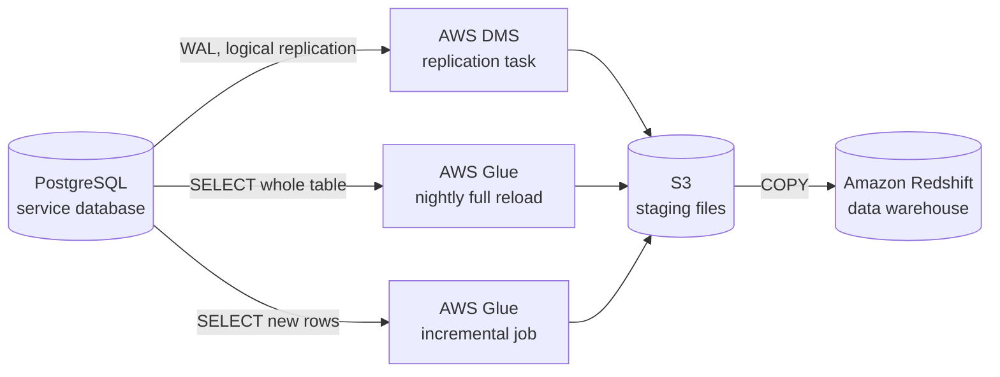

## Loading a Data Warehouse with AWS DMS and Glue

A common setup on AWS: the services keep their data in PostgreSQL, and a data team copies it into a data warehouse (DWH) in Amazon Redshift. Reports and dashboards read Redshift, not the service databases.

The copy usually uses three methods side by side:

- **Change Data Capture (CDC) with AWS DMS** - near-real-time. Changes reach the warehouse a few minutes after they happen.
- **Full nightly reload with AWS Glue** - every night, the warehouse table is emptied and loaded again from scratch.
- **Incremental load with AWS Glue** - every run, only the new rows are copied.

The ideas behind full and incremental load are explained in [Full Load vs Incremental Load](../database-patterns/full-vs-incremental-load.md). This article is about the AWS tools that run them, and what a backend developer needs to know when their database is one of the sources.



All three paths write files to S3 first, and then load them into Redshift with `COPY`. Redshift loads big files from S3 much faster than row-by-row inserts.

---

## Method 1: CDC with AWS DMS

AWS DMS (Database Migration Service) reads the PostgreSQL write-ahead log (WAL), the log where PostgreSQL records every change before it writes it to the table files. Every `INSERT`, `UPDATE`, and `DELETE` is in the WAL, so DMS sees all of them: changes made by the application, manual SQL fixes, and deletes. This is the main advantage over Glue incremental loads, which cannot see deletes.

### The parts

- **Replication instance** - the server that runs the copy (or DMS Serverless, where AWS sizes it for you).
- **Source endpoint** - connection details for the PostgreSQL database.
- **Target endpoint** - connection details for Redshift.
- **Replication task** - which tables to copy and how. The migration type is one of:
  - `full-load` - copy the tables once, then stop.
  - `cdc` - copy only changes from now on.
  - `full-load-and-cdc` - copy the tables once, then keep copying changes. This is the usual choice.

### What the source database needs

DMS reads the WAL through **logical replication**. On Amazon RDS (Relational Database Service) or Aurora PostgreSQL, turn it on in the parameter group:

```
rds.logical_replication = 1
```

This sets `wal_level = logical` and needs a database restart.

DMS then creates a **replication slot** on the source. A replication slot is a marker that tells PostgreSQL: "keep all WAL from this point on, until the reader confirms it has processed it".

### Tables need a primary key

DMS uses the primary key to find the row in the warehouse when an `UPDATE` or `DELETE` comes in. Without a primary key, DMS does not apply updates and deletes for that table. The warehouse copy quietly stops matching the source.

Check your tables:

```sql
SELECT c.relname AS table_without_primary_key
FROM pg_class c
JOIN pg_namespace n ON n.oid = c.relnamespace
WHERE c.relkind = 'r'
  AND n.nspname = 'public'
  AND NOT EXISTS (
      SELECT 1 FROM pg_constraint p
      WHERE p.conrelid = c.oid AND p.contype = 'p'
  );
```

### The replication slot can fill your disk

This is the most important thing for the team that owns the source database.

The slot keeps WAL until DMS confirms it. If the DMS task stops (an error, a paused task, a deleted task that left its slot behind), PostgreSQL keeps **all** WAL from that point. The disk fills up, and when it is full, the database stops accepting writes. Your service is down because of a reporting job.

Check the slots and how much WAL each one holds:

```sql
SELECT
    slot_name,
    active,
    pg_size_pretty(pg_wal_lsn_diff(pg_current_wal_lsn(), restart_lsn)) AS retained_wal
FROM pg_replication_slots;
```

An inactive slot with a growing `retained_wal` is a problem. On RDS, add a CloudWatch alarm on `OldestReplicationSlotLag` and `TransactionLogsDiskUsage`.

Since PostgreSQL 13 you can also set a limit. When a slot holds more WAL than this, PostgreSQL marks the slot as lost and frees the WAL. This breaks the DMS task, but keeps the database running:

```
max_slot_wal_keep_size = 50GB
```

The DMS task then needs a new full load to recover. That is better than a full disk.

### Large text columns are cut by default

DMS treats `text`, `jsonb`, `json`, and `bytea` columns as LOBs (Large Objects). In **limited LOB mode**, which is common because it is fast, every LOB value longer than `LobMaxSize` (32 KB by default) is cut to that size. There is no error, only a warning in the task log.

If a table has long JSON documents or long text, either raise `LobMaxSize` above the longest real value, or use full LOB mode for that table (slower).

### How fresh is the data?

DMS reports its delay in CloudWatch:

- `CDCLatencySource` - seconds between a change in PostgreSQL and DMS reading it.
- `CDCLatencyTarget` - seconds between a change in PostgreSQL and DMS writing it to Redshift.

A delay of a few minutes is normal, because DMS collects changes into batches before it loads them into Redshift. A delay that keeps growing means DMS cannot keep up, often because of one big batch job on the source (an `UPDATE` of millions of rows becomes millions of separate changes).

---

## Method 2: Full Nightly Reload with AWS Glue

AWS Glue runs ETL (Extract, Transform, Load) jobs on managed Apache Spark. You write a Python script, Glue runs it on servers it starts for each run, and you pay for the run time.

A full reload job reads the whole source table and replaces the warehouse table:

```python
import sys
from awsglue.context import GlueContext
from awsglue.job import Job
from awsglue.utils import getResolvedOptions
from pyspark.context import SparkContext

args = getResolvedOptions(sys.argv, ["JOB_NAME", "TempDir"])
glue_context = GlueContext(SparkContext.getOrCreate())
job = Job(glue_context)
job.init(args["JOB_NAME"], args)

payments = glue_context.create_dynamic_frame.from_options(
    connection_type="postgresql",
    connection_options={
        "useConnectionProperties": "true",
        "connectionName": "service-postgres",
        "dbtable": "public.payment",
    },
)

glue_context.write_dynamic_frame.from_options(
    frame=payments,
    connection_type="redshift",
    connection_options={
        "useConnectionProperties": "true",
        "connectionName": "dwh-redshift",
        "dbtable": "dwh.payment_new",
        "redshiftTmpDir": args["TempDir"],
        "preactions": "DROP TABLE IF EXISTS dwh.payment_new; "
                      "CREATE TABLE dwh.payment_new (LIKE dwh.payment);",
        "postactions": "DROP TABLE IF EXISTS dwh.payment_old; "
                       "BEGIN; "
                       "ALTER TABLE dwh.payment RENAME TO payment_old; "
                       "ALTER TABLE dwh.payment_new RENAME TO payment; "
                       "COMMIT; "
                       "DROP TABLE dwh.payment_old;",
    },
)

job.commit()
```

`preactions` and `postactions` are SQL that Glue runs in Redshift before and after it loads the data. Here they build the new copy in a separate table and swap it in at the end. Readers never see an empty or half-loaded table. The first `DROP TABLE IF EXISTS dwh.payment_old` removes a table left behind by an earlier failed run, so the rename does not fail.

One catch: a normal Redshift view is bound to the table itself, not to its name. After the swap, such a view still reads `payment_old`, and `DROP TABLE dwh.payment_old` fails because the view depends on it. Create views on swapped tables as late-binding views (`CREATE VIEW ... WITH NO SCHEMA BINDING`), which look up the table by name when they run.

The simpler form, `"preactions": "TRUNCATE dwh.payment;"`, leaves the table empty for the whole load. In Redshift, `TRUNCATE` also commits at once, so a failed load cannot be rolled back. See [Full Load vs Incremental Load](../database-patterns/full-vs-incremental-load.md) for more on this.

### Things to know as the source owner

- **The job reads your whole table every night.** On a big table, this is a long query with heavy disk reads. Point Glue at a read replica, not the primary database.
- **A long read on a replica can be cancelled.** On a streaming replica, a long query may conflict with changes coming from the primary and fail with `canceling statement due to conflict with recovery`. If this happens, the job needs a retry, or the replica needs `hot_standby_feedback = on` (which has its own cost on the primary).
- **Read in parallel.** By default, Glue reads a JDBC (Java Database Connectivity) table with one query. For big tables, set `hashfield` and `hashpartitions` in the connection options, so Glue splits the read into several smaller queries.

### Schedules run in UTC

Glue schedules (triggers) use cron expressions in UTC, and UTC does not change for summer time. So the local start time moves twice a year. For example, a job scheduled at `cron(0 0 * * ? *)` (00:00 UTC) starts at 1:00 in Germany in winter (UTC+1) and at 2:00 in summer (UTC+2). If a job must be finished by a fixed local time, schedule it for the summer case, or chain the jobs with a Glue workflow (start the next job when the previous one succeeds) instead of fixed times.

---

## Method 3: Incremental Load with AWS Glue

For big tables, a full reload every night is too slow. An incremental job copies only the new rows. Glue has a built-in way to remember where the last run stopped: **job bookmarks**.

Turn bookmarks on in the job settings (`--job-bookmark-option job-bookmark-enable`), and tell Glue which column to track:

```python
payments = glue_context.create_dynamic_frame.from_options(
    connection_type="postgresql",
    connection_options={
        "useConnectionProperties": "true",
        "connectionName": "service-postgres",
        "dbtable": "public.payment",
        "jobBookmarkKeys": ["id"],
        "jobBookmarkKeysSortOrder": "asc",
    },
    transformation_ctx="payments_source",
)

# ... write to Redshift ...

job.commit()  # saves the bookmark
```

How it works:

- Glue stores the highest `id` it has read. The next run reads only rows with a higher `id`.
- `transformation_ctx` is the name the bookmark is stored under. Without it, bookmarks do not work for that source, and every run reads the whole table again.
- The bookmark is saved only at `job.commit()`. If the job fails before that, the next run reads the same rows again. So the write must be safe to repeat (no duplicates).

### What a bookmark on id cannot see

A bookmark on `id` only finds **new** rows. It never sees:

- **Updates** - an updated row keeps its `id`, which is already behind the bookmark.
- **Deletes** - a deleted row is gone.

So an incremental load by `id` is only correct for tables where rows are inserted and never changed: logs, history tables, events.

For tables where rows are updated, use an `updated_at` column as the bookmark key, and merge the rows into the warehouse table instead of only adding them. Then the problems from [Full Load vs Incremental Load](../database-patterns/full-vs-incremental-load.md) apply: `updated_at` must always be set (best with a trigger), it must have an index, and deletes are still not seen.

There is one more gap, for bookmarks on both `id` and `updated_at`: rows that commit late. A transaction can get its `id` or `updated_at` value before the job runs, but commit after the job has read the table. The job does not see the row yet, and saves a bookmark that is already past the row's value. The next run reads only values above the bookmark, so the row is never copied. The usual fix is to re-read a few minutes before the last saved value, but Glue bookmarks cannot do that. A regular full reload (for example once a week) catches these rows.

### Merge, do not only insert

Redshift does not enforce primary keys. If the same row arrives twice (a retried run, or an updated row), a plain insert creates a duplicate. Load into a staging table, then merge:

```python
"dbtable": "staging.payment_increment",
"preactions": "TRUNCATE staging.payment_increment;",
"postactions": "BEGIN; "
               "DELETE FROM dwh.payment USING staging.payment_increment s "
               "WHERE dwh.payment.id = s.id; "
               "INSERT INTO dwh.payment SELECT * FROM staging.payment_increment; "
               "COMMIT;",
```

`TRUNCATE` is fine here, because it empties only the staging table, which no report reads.

---

## Which Method for Which Table

| Table | Method | Why |
|---|---|---|
| Needed in reports within minutes | DMS CDC | Only option with a delay of minutes |
| Rows are deleted, data must be exact | DMS CDC, or Glue full reload | Incremental loads cannot see deletes |
| Small or medium size | Glue full reload | Simple, always correct the next morning |
| Large, insert-only (logs, history) | Glue incremental by `id` + periodic full reload | Fast; the full reload catches rows that committed late |
| Large, rows are updated, no deletes | Glue incremental by `updated_at` + merge | Fast, if `updated_at` can be trusted |

In practice, DMS is usually kept for a limited set of databases that really need fresh data. It costs more to run, and every source database must allow logical replication and carry a replication slot. Everything else goes through nightly Glue jobs.

---

## Reports Mix Data of Different Ages

When you read the warehouse, remember that tables can be loaded by different methods:

- A table loaded by DMS is a few minutes old.
- A table loaded by a nightly Glue job shows the state from last night.

A report that joins the two can show impossible results. For example, a payment from this morning (copied by DMS) points to an order that does not exist yet in the warehouse (the order table is copied only at night). The join drops the payment, or shows it with empty order fields.

Before you trust such a report, check how each table is loaded and when it was last loaded. If the data team keeps a load timestamp column (for example `dwh_loaded_at`), show it in the report.

---

## Checklist for Backend Teams

If your service database is a source for the warehouse:

- **Every table has a primary key.** DMS needs it for updates and deletes. Merges in Glue need it too.
- **`updated_at` is set by a trigger**, if any table is loaded incrementally by it.
- **Use soft deletes** (`deleted_at`) for tables loaded incrementally, or the deletes never reach the warehouse.
- **Alarm on replication slot size** if DMS reads your database. A stopped task can fill your disk.
- **Tell the data team before schema changes.** Renaming or dropping a column can break a DMS task or a Glue job, and the warehouse silently stops updating.
- **Big batch updates create big CDC delays.** Updating millions of rows at once creates millions of changes for DMS. Run them in smaller batches.
- **Glue reads from a replica**, not from the primary.

---

### For AI agents

```
Loading a Redshift data warehouse from PostgreSQL on AWS. Three methods: (1) AWS DMS CDC - reads the WAL through logical replication (RDS: rds.logical_replication = 1, needs restart), task type full-load-and-cdc, delay of minutes, sees inserts, updates, deletes and manual SQL fixes. Requirements and risks: tables need a primary key or updates/deletes are not applied; the replication slot keeps WAL until DMS confirms it, so a stopped task fills the source disk - monitor pg_replication_slots, CloudWatch OldestReplicationSlotLag and TransactionLogsDiskUsage, consider max_slot_wal_keep_size (PostgreSQL 13+); limited LOB mode cuts text/jsonb/json/bytea values over LobMaxSize (default 32 KB) without error; freshness via CDCLatencySource/CDCLatencyTarget; big batch updates cause big delays. (2) AWS Glue full nightly reload - Spark job reads the whole table via JDBC, writes to Redshift through S3 (redshiftTmpDir) and COPY; use preactions/postactions to load a new table and swap it in, not TRUNCATE (Redshift TRUNCATE commits at once, readers see an empty table); read from a replica; use hashfield/hashpartitions for parallel reads. Glue schedules are cron in UTC, so local start times move by one hour with summer time. (3) AWS Glue incremental - job bookmarks (job-bookmark-enable, jobBookmarkKeys, transformation_ctx required, saved only at job.commit()); bookmark on id finds only new rows (no updates, no deletes) - use only for insert-only tables; for updated rows use updated_at (trigger-managed, indexed) and merge via staging table (delete+insert) since Redshift does not enforce primary keys; bookmarks (on id or updated_at) cannot re-read an overlap window, so late-committing rows are lost - add a periodic full reload. Views on swapped tables must be late-binding (WITH NO SCHEMA BINDING). Reports joining tables loaded by different methods mix data of different ages.
```

Reference: `https://michalsniezko.github.io/database-patterns/dwh-loading-aws-dms-glue.html`
